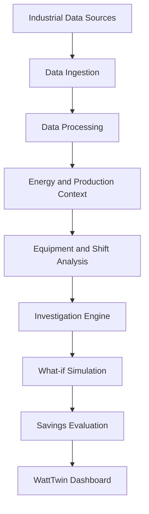

# WattTwin ⚡
### Production-Aware Energy Intelligence for Smarter Manufacturing

**WattTwin** is an industrial energy intelligence platform designed to help manufacturing facilities understand, investigate, and reduce energy inefficiencies by connecting energy consumption with production activity.

Instead of treating energy usage as an isolated metric, WattTwin focuses on the relationship between **energy, equipment, production shifts, and operational decisions**.

The goal is to move beyond passive energy monitoring toward evidence-driven investigation and production-aware energy optimisation.

---

## 🎯 The Problem

Manufacturing facilities can experience significant energy inefficiencies due to:

- Equipment consuming energy while idle or underutilised.
- Furnace temperature overshooting and inefficient thermal operation.
- Compressed-air leakage and avoidable energy losses.
- Inefficient production scheduling and machine utilisation.
- Limited visibility into energy consumption across shifts and production batches.

Traditional energy dashboards often show how much energy was consumed, but provide limited context about why it happened or what operational changes could improve efficiency.

**WattTwin aims to bridge this gap.**

## 💡 Our Approach

WattTwin brings together industrial energy data, production context, equipment-level analysis, and optimisation workflows in one interface.

The platform is designed around three questions:

1. **What happened?** — Identify energy consumption patterns and deviations.
2. **Why did it happen?** — Investigate equipment, shifts, and production conditions.
3. **What can be improved?** — Explore operational changes and evaluate potential energy savings.

## ✨ Key Features

### 1. Control Center
A centralised view of industrial energy performance, operational indicators, and investigation priorities.

### 2. Evidence & Investigation
Explore energy-related anomalies and investigate potential inefficiencies using operational evidence rather than relying only on aggregate consumption figures.

### 3. Shifts & Batch Analysis
Understand energy consumption in the context of production shifts and manufacturing batches.

### 4. Equipment & Specific Energy Consumption (SEC)
Examine equipment-level energy performance and specific energy consumption to understand how efficiently energy is being used relative to production output.

### 5. Energy Flow Visualisation
A Sankey-style visualisation to understand how energy flows through different parts of the industrial system and where losses may occur.

### 6. What-if Simulation
Experiment with operational scenarios and evaluate how changes in equipment usage, scheduling, or operating conditions could affect energy consumption.

### 7. Verified Savings
A dedicated workflow for reviewing and tracking energy-saving opportunities, with an emphasis on distinguishing estimated savings from verified results.

### 8. Data Import
Load CSV-based industrial data to explore energy and production performance without requiring an always-connected industrial sensor setup.

---

## 🏗️ System Architecture

WattTwin follows a modular, production-aware approach to industrial energy analysis.



### Core Data Sources

The platform is designed to work with:

- Historical energy consumption data.
- Equipment operating information.
- Production and batch records.
- Shift-level operational data.
- Simulated industrial datasets for development and testing.

The architecture is intended to support future integration with real-world sensors and industrial data systems.

---

## 🛠️ Technology Stack

| Layer | Technologies |
|---|---|
| Frontend | React, TypeScript |
| Build Tool | Vite |
| Visualisation | Interactive dashboard and Sankey-style energy flows |
| Data Input | CSV-based industrial data |
| Analytics | Production-aware energy analysis |
| Simulation | What-if operational scenarios |

---

## 🚀 Getting Started

### Prerequisites

- Node.js
- npm
- Git

### 1. Clone the repository

```bash
git clone <YOUR_GITHUB_REPOSITORY_URL>
```

### 2. Navigate to the project directory

```bash
cd <YOUR_REPOSITORY_NAME>
```

### 3. Install dependencies

```bash
npm install
```

### 4. Start the development server

```bash
npm run dev
```

### 5. Open the application

Visit the local URL displayed in your terminal, typically:

```text
http://localhost:5173
```

---

## 📊 Development Philosophy

WattTwin is built around a few important engineering principles:

- **Production context matters:** Energy efficiency should be evaluated alongside manufacturing output.
- **Evidence before recommendations:** Operational insights should be traceable to underlying data.
- **Simulation before deployment:** Potential improvements can be explored without immediately changing real factory operations.
- **Modular architecture:** Data ingestion, analysis, visualisation, and optimisation should remain independently extensible.
- **Practical accessibility:** The platform should support data-driven experimentation even when physical industrial infrastructure is unavailable.

---

## 🗺️ Roadmap

### Phase 1 — Energy Intelligence Foundation
- [x] Interactive industrial dashboard foundation
- [x] Equipment and production-oriented views
- [x] CSV data loading workflow
- [x] Energy-flow visualisation
- [x] What-if simulation interface
- [ ] Expanded real-world industrial dataset validation

### Phase 2 — Predictive Intelligence
- [ ] Integration of historical APMC-style industrial/operational datasets where relevant
- [ ] Weather-informed energy demand analysis
- [ ] Energy consumption forecasting
- [ ] Anomaly detection for equipment-level inefficiencies
- [ ] More advanced optimisation recommendations

### Phase 3 — Connected Industrial Intelligence
- [ ] Real-time sensor integration
- [ ] PLC and industrial data connectivity
- [ ] Continuous equipment monitoring
- [ ] Production-aware scheduling optimisation
- [ ] Carbon-emission impact analysis

*Roadmap items describe planned development, not necessarily currently implemented functionality.*

---

## 🔬 Current Project Status

WattTwin is an evolving engineering prototype focused on production-aware industrial energy intelligence.

The current development prioritises dashboard workflows, industrial data exploration, equipment analysis, and simulation-based investigation.

The platform is designed to progressively evolve toward real-world industrial data integration and predictive optimisation.

---

## 👩‍💻 Author

**Priyanshi Gahlawat**

Computer Science Engineering Student | Full-Stack Developer

- GitHub: [@Gahlawat-9](https://github.com/Gahlawat-9)

---

## 📌 Vision

**Factories should not just know how much energy they consume. They should understand why they consume it, where it is being wasted, and what they can do differently.**

WattTwin aims to make that possible through production-aware energy intelligence.
